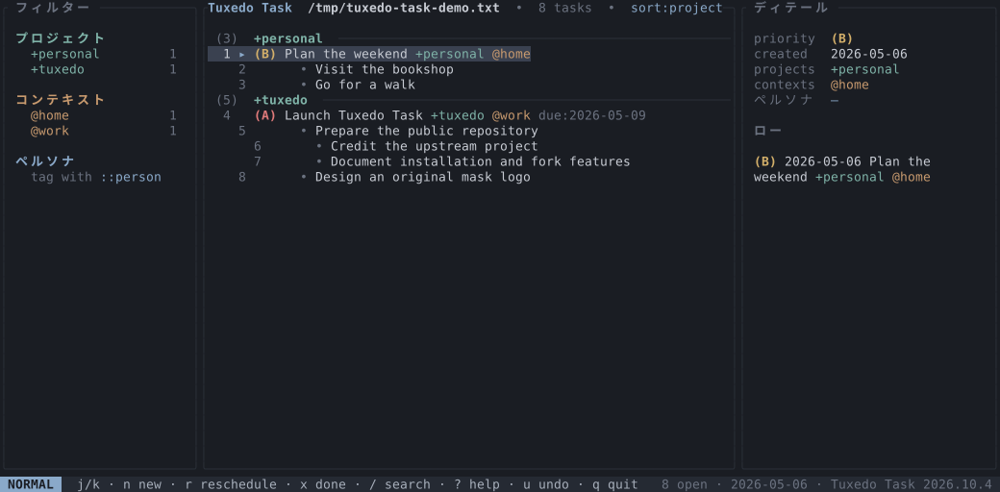

# Tuxedo Task

<a href="https://en.wikipedia.org/wiki/Tuxedo_Mask"></a>

**Your tasks, with a little more structure.** A keyboard-driven terminal app for
[todo.txt](http://todotxt.org/), with nested subtasks, projects, contexts, and
Persona assignments — all in plain-text files you own.

[](https://github.com/Caracolaracol/tuxedo-task/actions/workflows/ci.yml)
[](#license)

[Website](https://caracolaracol.github.io/tuxedo-task/) · [Documentation & tutorials](Docs/README.md) · [Releases](https://github.com/Caracolaracol/tuxedo-task/releases/latest)



## Features

- **Plain-text tasks:** priorities, due dates, recurrence, and visibility dates.
- **Task families:** nested subtasks, subtree editing, and family-aware actions.
- **Organization:** projects, contexts, Persona assignees, and project grouping.
- **Finding your work:** fuzzy search, combined filters, remembered filters, and saved searches.
- **Keyboard-first TUI:** Vim-style navigation, command palette, custom shortcuts, and help.
- **Editing:** offline natural-language entry in English, autocomplete, calendars, and recurrence controls.
- **Task management:** rescheduling, multi-select, bulk actions, undo, and an archive view.
- **Notes:** linked Markdown notes in your preferred editor.
- **Mouse support:** click, scroll, filter, and copy task text locally or over SSH.
- **Personalization:** five built-in themes, custom themes, three densities, and configurable panels.
- **Phone capture:** QR access to a small LAN PWA and a plain-text inbox.
- **Reliable local storage:** automatic atomic saves, external-change detection, and settings hot reload; no account, database, or required cloud service.
- **Optional CLI:** todo.txt-style commands, shell automation, and JSON output.
- **Cross-platform:** macOS, Linux, and Windows; precompiled releases and update notices.

[Explore the guides](Docs/README.md) · [See what this fork adds](Docs/fork.md)

## Install

**macOS / Linux** — with [Homebrew](https://brew.sh/):

```sh
brew install caracolaracol/tap/tuxedotask
```

**Windows** — download [Tuxedo Task Setup.exe](https://github.com/Caracolaracol/tuxedo-task/releases/latest/download/tuxedo-task-windows-x86_64-setup.exe).
It installs for your user; reopen your terminal or use the Start menu shortcut.
The installer is unsigned: SmartScreen may warn. Use the official release and
[verify its checksum](Docs/cli.md#verify-a-windows-installer); do not disable Windows security.

Neither option requires Rust or Cargo. Both `tuxedo` and `tuxedotask` open the
same app. For portable downloads, source builds, updates, or switching from
upstream Tuxedo, see the [installation guide](Docs/installation.md).

## Quick start — TUI

Open the interactive app with the path where you want your tasks:

```sh
tuxedo "$HOME/Documents/tasks/todo.txt"
```

Windows PowerShell:

```powershell
tuxedo "$HOME\Documents\tasks\todo.txt"
```

The app creates a missing file and parent folders; existing contents are kept.
Running just `tuxedo` opens your configured/default file or a welcome screen:
`c` creates a list in the current folder, and `s` tries a temporary sample.

| Key | Action |
| --- | --- |
| `n` | Add a task; `Enter` saves (review and confirm again if natural-language parsing rewrites it) |
| `j` / `k` or arrows | Move between tasks |
| `i` | Edit the selected task |
| `x` / `u` | Complete / undo |
| `>` / `<` | Nest / unnest a task family |
| `m` | Assign or remove a Persona |
| `/` · `fp` · `fc` · `fm` | Search or filter by project, context, or person |
| `:` / `?` | Command palette / help |
| `q` | Quit — changes save automatically |

[First-task tutorial](Docs/getting-started.md) · [All shortcuts](Docs/keybindings.md) · [Optional CLI reference](Docs/cli.md)

## About this fork

**Tuxedo Task is an independent community fork of
[Tuxedo by Webstone Technologies](https://github.com/webstonehq/tuxedo), maintained
by [Caracolaracol](https://github.com/Caracolaracol).** It is not an official
Webstone release. The original project and its contributors built the foundation;
this fork preserves their MIT license and copyright.

The mask motif is a playful nod to **Tuxedo Mask** from *Sailor Moon*, created by
Naoko Takeuchi. The app uses its own original mask design, not the character
artwork above, and is not affiliated with or endorsed by the rights holders.
The externally hosted character image is non-free: [source and rights information](https://en.wikipedia.org/wiki/File:TuxedoMask.jpg).
Its appearance on Wikipedia is not a grant of reuse rights.

## Contributing & credits

[Issues and ideas](https://github.com/Caracolaracol/tuxedo-task/issues) and pull
requests are welcome. See [development](Docs/development.md) for checks and
contribution guidance.

Thanks to the original Tuxedo contributors, Gina Trapani and
[todo.txt](http://todotxt.org/), [ratatui](https://ratatui.rs/), and
[crossterm](https://github.com/crossterm-rs/crossterm).
[More credits and support](Docs/support.md).

## License

Code and original project assets are released under the [MIT License](LICENSE).
The original Webstone Technologies Inc copyright notice is preserved. The
Tuxedo Mask reference image is **not covered by MIT**. Website decorations have
separate licenses: Openclipart roses are CC0, and Twemoji roses are CC BY 4.0;
see [third-party credits](website/THIRD_PARTY.md).
