# Screens

| | |
| --- | --- |
| **Empty state** • original mask mark and quick-start when the file has no tasks | 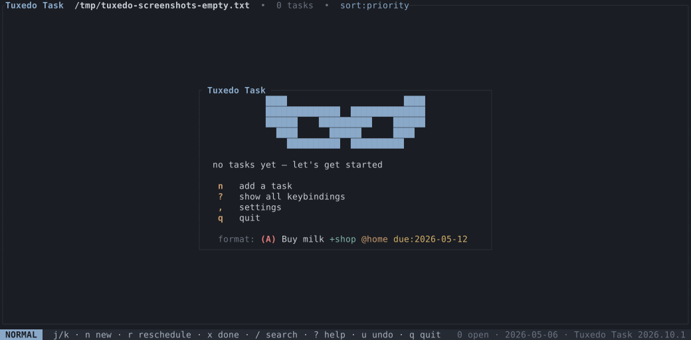 |
| **Nested subtasks** • parent/child families grouped by project | 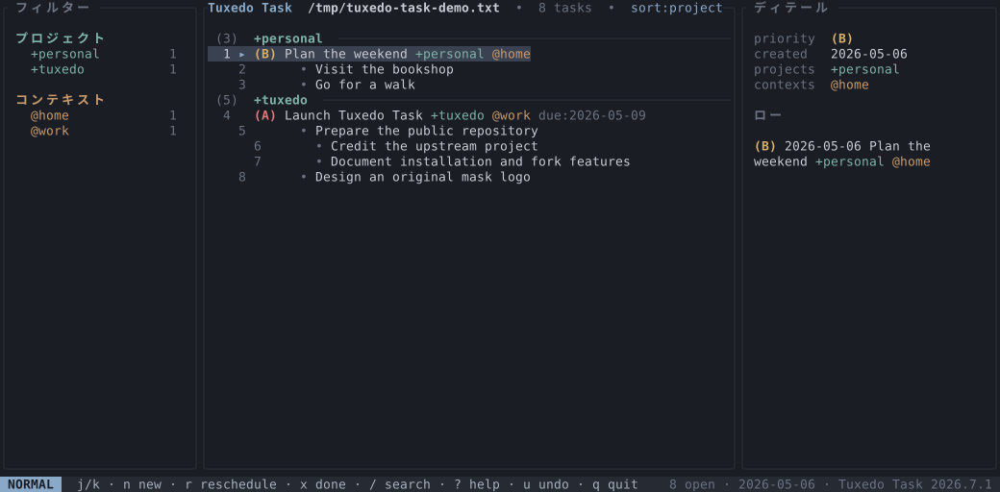 |
| **List** • list of todos, optionally grouped | 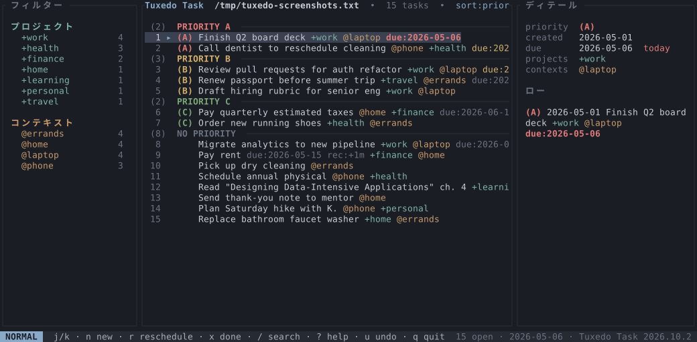 |
| **Archive** • completed tasks grouped by completion date | 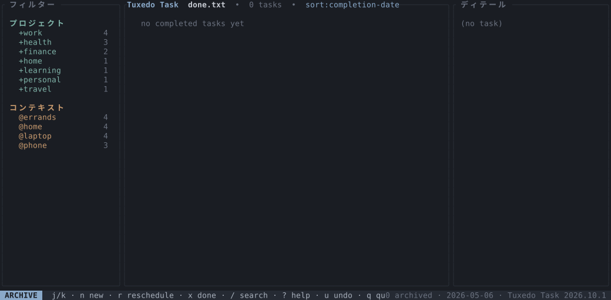 |
| **Filter sidebar active** • `fp` cycles projects with j/k, `fc` cycles contexts; saved searches list under a **SAVED** heading with live match counts | 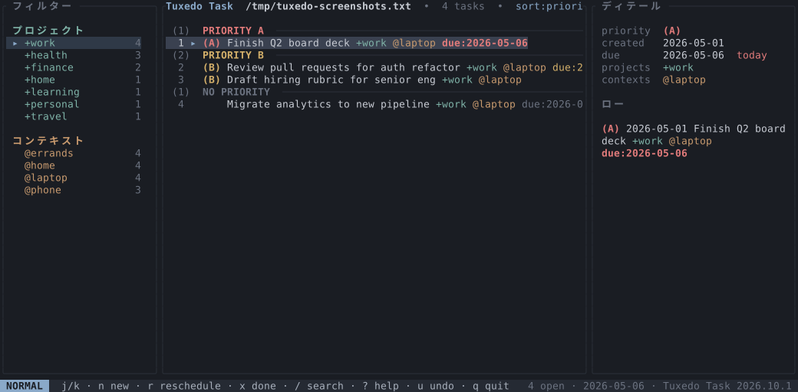 |
| **Persona filter** • assign tasks with `m`, then filter by person with `fm` | 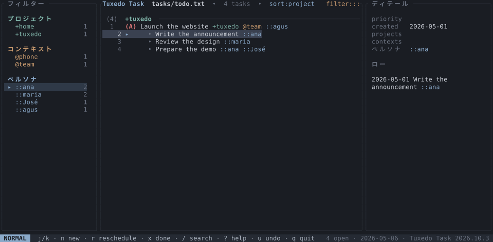 |
| **Command palette** • `:` or `Ctrl-P` opens a fuzzy palette over every action | 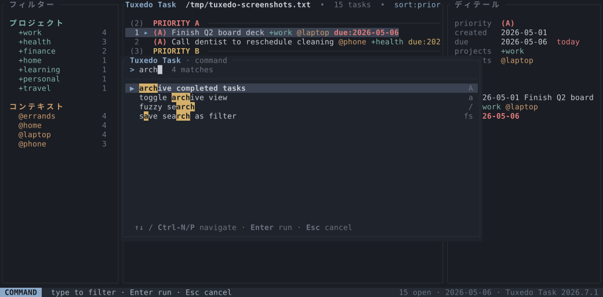 |
| **Help** • `?` opens the full keybindings overlay | 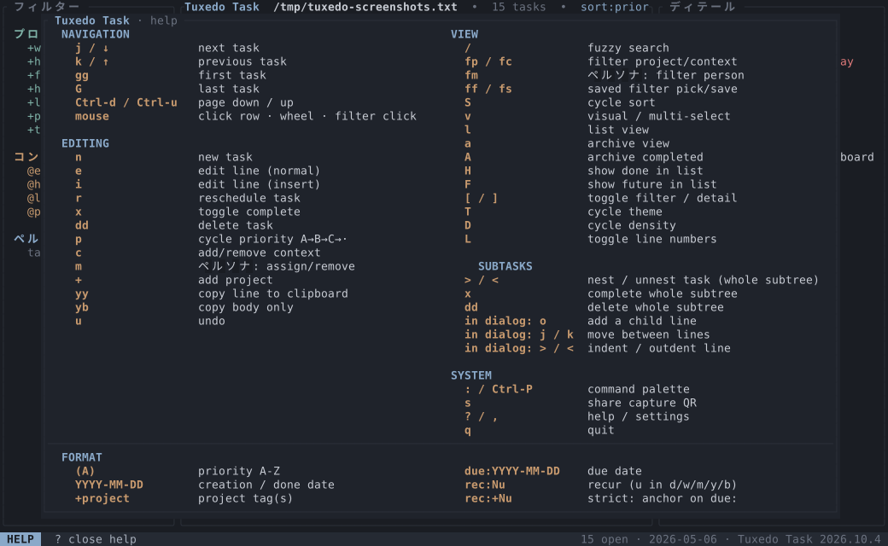 |

## Built-in themes

| Muted Slate (default) | Dawn |
| --- | --- |
|  | 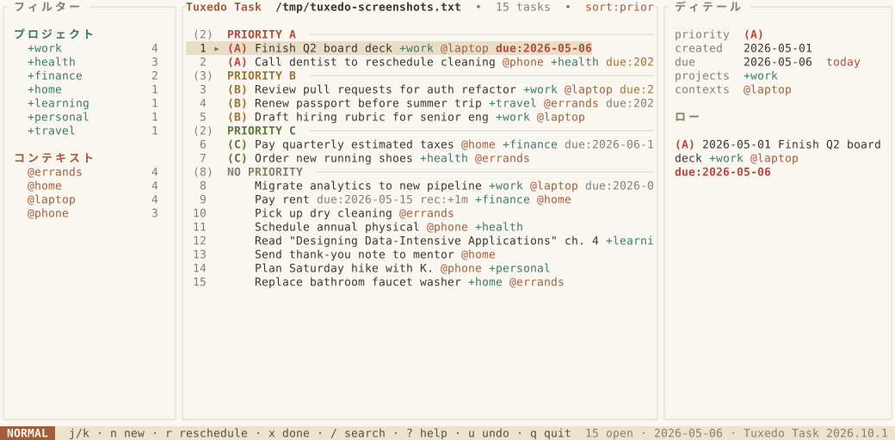 |
| **Nord** | **Matrix** |
| 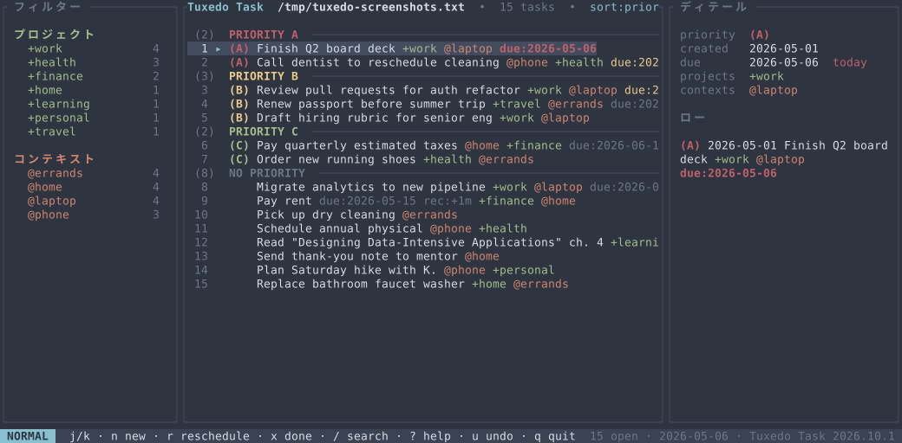 | 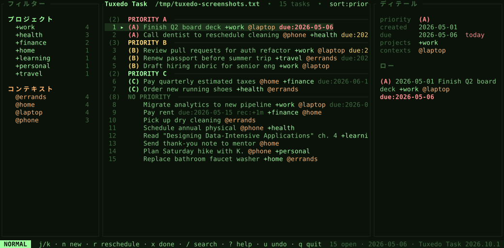 |
| **Terminal** | |
| 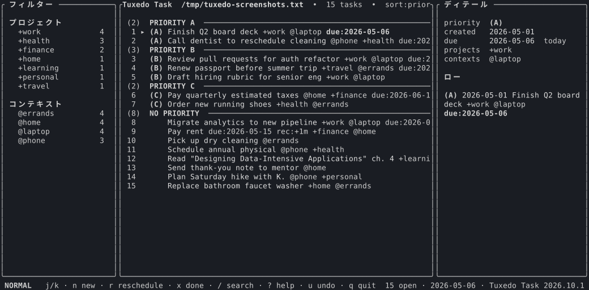 | |

    
How to generate the screenshots and demo

    
The screenshots in the table above are checked-in SVGs. Regenerate them with:

    <pre>mise run screenshots</pre>
    
An optional demo recording can be generated with <a href="https://github.com/charmbracelet/vhs">vhs</a> from <code>docs/demo.tape</code> (requires VHS and its dependencies):

    <pre>mise run demo</pre>

---

[Documentation index](README.md) · [Project overview](../README.md)
